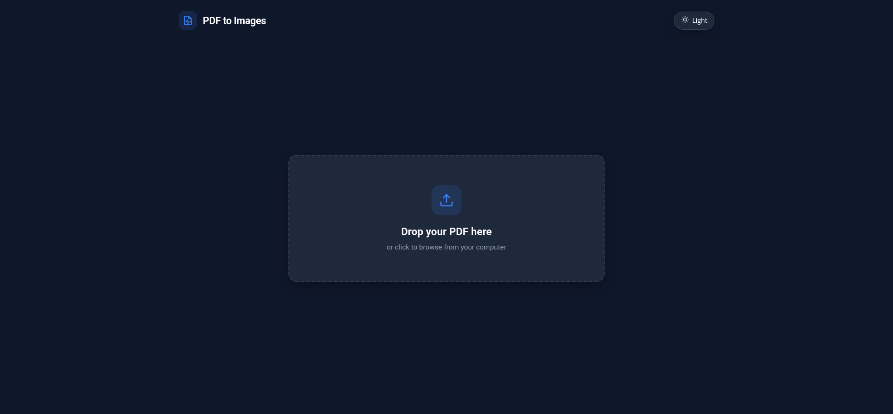
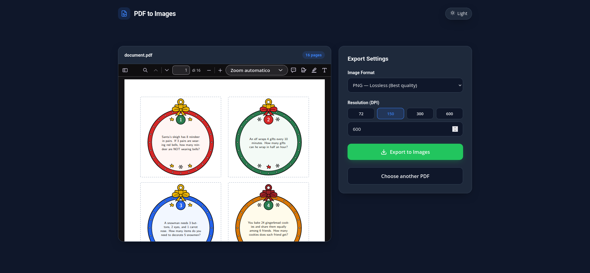
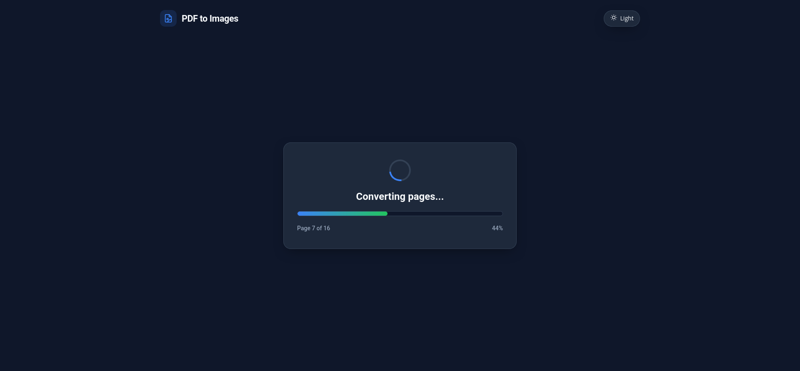
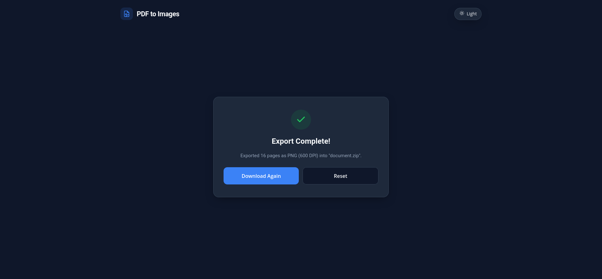

<h1>📄 PDF to Images 🖼️</h1>

A modern, privacy-first, 100% client-side web app to convert every page of a PDF document into high-resolution images directly in your browser. Featuring drag-and-drop upload, live preview, custom DPI &amp; format controls, and instant ZIP export—without any server uploads.

  <a href="http://paypal.me/R0mb0">
    <picture>
      <source media="(prefers-color-scheme: dark)" srcset="https://github.com/R0mb0/Support_the_dev_badge/blob/main/Badge/SVG/Support_the_dev_badge_Dark.svg">
      <source media="(prefers-color-scheme: light)" srcset="https://github.com/R0mb0/Support_the_dev_badge/blob/main/Badge/SVG/Support_the_dev_badge_Light.svg">
      
    </picture>
  </a>

---

<h2><a href="https://r0mb0.github.io/Pdf_to_images/">👉 Click here to test the app! 👈</a></h2>

<h2>🚀 Features</h2>
<ul>
<li><strong>Local Processing</strong>: PDF rendering and image conversion happen entirely in your browser using PDF.js, HTML5 Canvas, and JSZip. Your documents are never uploaded to any server!</li>
<li><strong>Live Document Preview</strong>: Inspect and scroll through your uploaded PDF directly inside the workspace using your browser's native PDF viewer before exporting.</li>
<li><strong>Multiple Output Formats</strong>: Export pages as PNG (lossless), JPEG, WebP, or AVIF, with an adjustable compression quality slider for lossy formats.</li>
<li><strong>Custom DPI Resolution</strong>: Pick from quick presets (72, 150, 300, 600 DPI) or enter a custom DPI value to balance crisp print quality and file size.</li>
<li><strong>Real-Time Progress &amp; Instant ZIP</strong>: Track conversion progress page by page, then automatically download a ZIP archive named after your original PDF—with built-in "Download Again" and "Reset" options.</li>
<li><strong>Modern Adaptive UI</strong>: Clean rounded interface with smooth animations and automatic Dark/Light mode following your system preferences, plus a manual theme toggle.</li>
<li><strong>Offline-Ready Setup</strong>: All external library references are grouped at the top of <code>index.html</code> so you can easily download and run the app completely offline.</li>
</ul>

<h2>🛠️ How it works</h2>
<ol>
<li><strong>Drag and drop</strong> your PDF file into the upload area (or click to browse from your computer).</li>
<li>Review your document in the left preview panel and configure your desired <strong>image format</strong>, <strong>quality</strong>, and <strong>DPI</strong> on the right.</li>
<li>Click <strong>Export to Images</strong> to start the conversion and watch the live page-by-page progress bar.</li>
<li>The app renders each PDF page onto an HTML5 Canvas via PDF.js and packs all generated images into a single ZIP archive using JSZip.</li>
<li>Your ZIP file downloads automatically as soon as processing completes (and you can re-download it or hit <strong>Reset</strong> for a new document).</li>
</ol>

<h2>🏆 What makes it special?</h2>
<ul>
<li><strong>100% Client-Side Architecture</strong>: Everything runs locally on your device. No backend logic, no server costs, and no file-size upload limits.</li>
<li><strong>No Server Bottlenecks</strong>: Conversion speed depends solely on your own hardware—no waiting in online queues or uploading heavy PDFs over slow connections.</li>
</ul>

<h2>💡 Why use this tool?</h2>
<ul>
<li><strong>Absolute Privacy</strong>: Safely extract pages from sensitive contracts, invoices, IDs, or personal documents knowing they will never leave your computer.</li>
<li><strong>Ready for Any Workflow</strong>: Quickly turn presentations, brochures, or multi-page reports into web-ready WebP/JPGs or print-ready 300+ DPI PNGs without installing heavy desktop software.</li>
</ul>

<h2>⚡ Getting Started</h2>

<h3>Online</h3>

Simply visit the <a href="https://r0mb0.github.io/Pdf_to_images/">Live Demo hosted on GitHub Pages</a>.

<h3>Local Installation</h3>

Running this tool locally is quick and easy:

<ol>
<li><strong>Clone this repository</strong> or download the source files.</li>
<li><em>(Optional, for 100% offline use)</em> Download <code>pdf.min.js</code>, <code>pdf.worker.min.js</code>, and <code>jszip.min.js</code> from the links commented at the top of <code>index.html</code> and update the local paths.</li>
<li>Serve the folder using a local web server (such as VS Code's <strong>Live Server</strong> or <code>python -m http.server</code>) and open it in your browser.</li>
<li>Done. The app is ready to use locally!</li>
</ol>

<a href="https://github.com/R0mb0/Crafted_with_AI">
<picture>
<source media="(prefers-color-scheme: dark)" srcset="https://github.com/R0mb0/Crafted_with_AI/blob/main/Badge/SVG/CraftedWithAIDark.svg">
<source media="(prefers-color-scheme: light)" srcset="https://github.com/R0mb0/Crafted_with_AI/blob/main/Badge/SVG/NotMadeByAILight.svg">

</picture>
</a>
